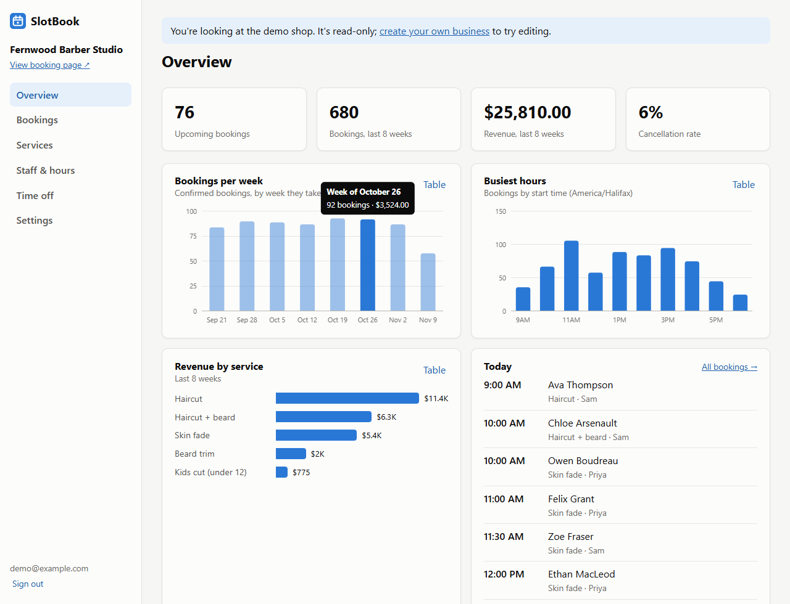
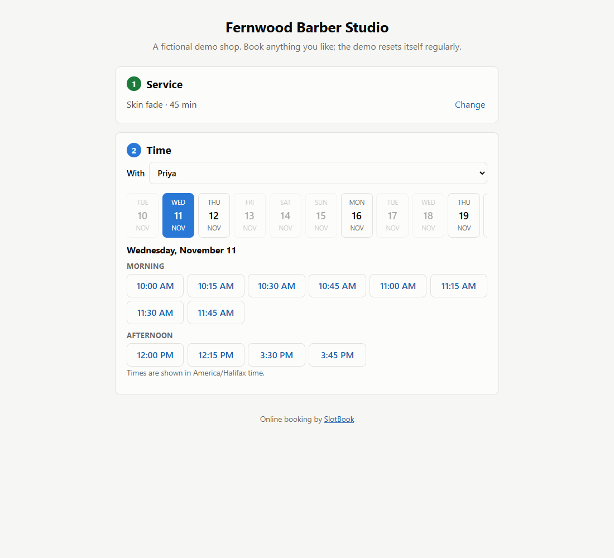
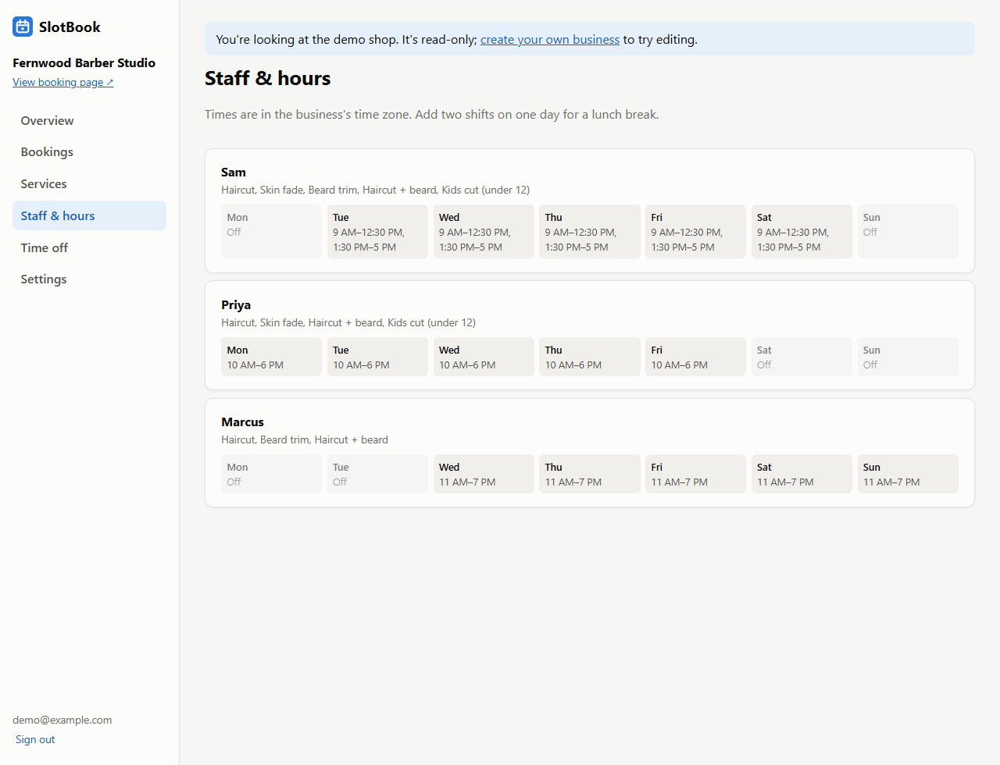

# SlotBook

Online appointment booking for small businesses. Any business can sign up and get its own public booking page. Customers pick a service, a staff member (or "anyone") and a free time, and get a confirmation email with a private link to reschedule or cancel. Owners run everything from an admin dashboard: services, staff and weekly hours, time off and holidays, bookings, and stats.

**Live demo:** https://slotbook-n97p.onrender.com. Book at the [demo shop](https://slotbook-n97p.onrender.com/b/demo), or open the read-only demo dashboard from the home page. It runs on Render's free tier, so the first load after it's been idle can take about a minute.



| Booking page | Staff & weekly hours |
|---|---|
|  |  |

## Features

**For customers (no account needed)**
- Pick a service, then a staff member or "anyone available"
- A date strip that only enables days with free times, then times grouped into morning, afternoon and evening
- Confirmation email with a private manage link to reschedule or cancel
- Times always shown in the business's time zone

**For business owners**
- Sign up creates your business and its booking URL (`/b/your-name`)
- Services with length, price and a clean-up buffer after each appointment
- Staff with the services they perform and weekly shifts (split shifts for lunch breaks)
- Time off for one person or the whole business (holidays)
- Booking rules: start-time interval, minimum notice, how far ahead people can book
- Bookings by week, with cancel-and-notify
- Dashboard: upcoming bookings, revenue, cancellation rate, bookings per week, revenue by service, busiest hours (each chart has a table view)
- Email when someone books

## Tech stack

- **Backend:** Python, FastAPI, SQLAlchemy 2.0, Pydantic, PyJWT; PostgreSQL in production (psycopg 3), SQLite locally
- **Frontend:** React 19 (Vite), React Router, hand-made SVG charts, plain CSS with light and dark themes
- **Testing:** pytest (including Postgres concurrency tests), end-to-end checks in headless Chrome
- **DevOps:** Docker (multi-stage), GitHub Actions with a Postgres service, Render + Neon

## How it works

```
backend/app/
  availability.py   pure slot engine: time zones, shifts, buffers, notice (no database)
  booking.py        free slots from the database, claiming a slot safely, reschedule/cancel
  stats.py          dashboard numbers, bucketed in the business's local time
  emails.py         confirmation / moved / cancelled emails (console, SMTP, or in-memory for tests)
  demo.py           the fictional demo business, rebuilt on startup
  routers/          auth, admin (per-business), public (booking page + manage links)
frontend/src/
  pages/booking/    booking flow, shared SlotPicker, manage page
  pages/admin/      dashboard pages
  components/       charts
```

### Finding free times

`availability.py` is pure functions, so the tricky rules are unit-tested without a database:

1. Turn each staff member's weekly hours for a date into real instants using the business's time zone. 9:00 in Halifax is 13:00 UTC in winter and 12:00 UTC in summer; `zoneinfo` handles daylight saving.
2. Collect busy intervals: confirmed bookings (including their buffer), the person's time off, and whole-business closures.
3. Walk each shift in steps of the slot interval. A start is offered if the appointment ends inside the shift, the appointment plus its buffer overlaps nothing busy, and it's after "now + minimum notice".

Intervals are half-open (`[start, end)`), so back-to-back bookings are allowed.

### Never double-booking

Listing slots and claiming one go through the same function, so the API can't accept a time it wouldn't have offered. Claiming happens in three layers:

1. **Re-check under a lock.** The staff member's row is locked with `SELECT ... FOR UPDATE`, then availability is checked again. Two requests racing for the same slot are serialised, and the second one gets a friendly "no longer available" error.
2. **Database constraint (Postgres).** An exclusion constraint makes Postgres itself refuse two confirmed bookings for the same staff member with overlapping time ranges:
   ```sql
   EXCLUDE USING gist (staff_id WITH =, tstzrange(starts_at, blocked_until) WITH &&) WHERE (status = 'confirmed')
   ```
   Even a bug in the application code couldn't create an overlap.
3. **Tested for real.** `tests/test_postgres.py` releases 8 threads at the same instant for one slot and asserts exactly one booking is created.

### Multi-tenancy

Every row belongs to a business. Admin queries always filter by the signed-in owner's `business_id`, and lookups by id return 404 (not 403) for another business's rows, so ids can't be probed. Tests check that one business can't read, edit, cancel or attach another's data.

### Customer manage links

Customers don't have accounts. Each booking gets a random token that's emailed to the customer; the database stores only its SHA-256 hash, like a password. The link allows viewing, rescheduling (the booking's own slot is offered back while picking) and cancelling until the appointment starts.

## Run locally

Requires Python 3.12+ and Node 20+.

```bash
# backend
cd backend
python -m venv .venv
source .venv/bin/activate          # Windows: .venv\Scripts\activate
pip install -r requirements.txt
uvicorn app.main:app --reload      # http://localhost:8000/docs

# frontend (second terminal)
cd frontend
npm install
npm run dev                        # http://localhost:5173
```

On Windows, `./start.ps1` opens both in their own windows. A SQLite file is created automatically and the demo shop is seeded on startup (`SEED_DEMO=0` turns that off). Emails are printed to the API's console.

Or run everything in one container:

```bash
docker build -t slotbook .
docker run -p 8000:8000 -e SECRET_KEY=change-me slotbook
```

### Configuration

| Variable | Default | Purpose |
|---|---|---|
| `DATABASE_URL` | `sqlite:///./slotbook.db` | Postgres URLs (`postgres://...`) work as-is |
| `SECRET_KEY` | random per start | Signs login tokens |
| `SEED_DEMO` | `1` | Rebuild the demo business on startup |
| `EMAIL_BACKEND` | `console` | `console`, `smtp`, or `memory` (tests) |
| `SMTP_HOST`, `SMTP_PORT`, `SMTP_USER`, `SMTP_PASSWORD`, `EMAIL_FROM` | | SMTP settings |
| `PUBLIC_URL` | request URL | Base for links in emails |

## Tests

```bash
cd backend
pytest
```

34 tests cover:
- the slot engine (DST, buffers, notice, split shifts)
- the booking API: double-booking, "anyone" assignment, never-offered times, time off, manage links, reschedule, cancel rules
- the admin API: validation, tenant isolation, read-only demo, stats

The two Postgres tests (exclusion constraint and 8 simultaneous requests for one slot) run when `TEST_DATABASE_URL` points at a Postgres database. CI starts one for every push.

```bash
docker run -d -p 5433:5432 -e POSTGRES_PASSWORD=pw -e POSTGRES_DB=slotbook_test postgres:17-alpine
TEST_DATABASE_URL=postgresql://postgres:pw@localhost:5433/slotbook_test pytest
```

## Design decisions

- **Store instants in UTC, hours as local wall-clock times.** A shift is "9:00 to 17:00 on Tuesdays", which means a different UTC time in summer and winter. Converting per date is the only way that stays right across daylight saving. A small `UTCDateTime` column type keeps every datetime timezone-aware, even on SQLite.
- **Money in integer cents, price copied onto the booking.** No floating-point rounding, and changing a price doesn't rewrite past revenue.
- **`blocked_until` on each booking.** It's the end time plus the buffer at booking time, so changing a service's buffer later can't make old bookings overlap.
- **Deactivate rather than delete.** Services and staff with bookings can't be deleted, only hidden, so history and stats stay intact.
- **Emails are built during the request but sent in the background.** A slow mail server never slows down booking, and a failed send never fails a booking.
- **A read-only demo login.** Recruiters can explore a dashboard with real-looking data without being able to vandalise it. The demo rebuilds itself on startup so its dates stay current.
- **The clock lives in one place (`app/clock.py`).** Tests freeze it, so date-based tests don't break as time passes.

## What I'd add next

- Rate limiting and a CAPTCHA on public booking
- Reminder emails the day before (a scheduled job)
- Staff logins with their own schedule view
- Calendar sync (iCal feed or Google Calendar)
- Online deposits with Stripe
- Alembic migrations once the schema starts changing
